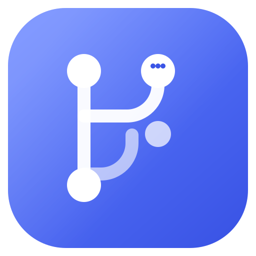
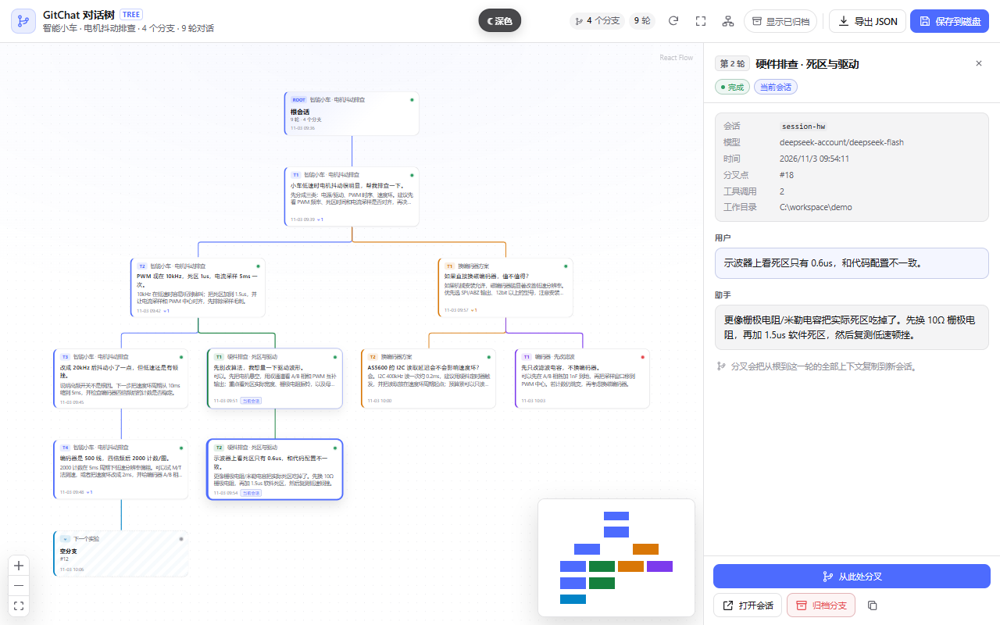
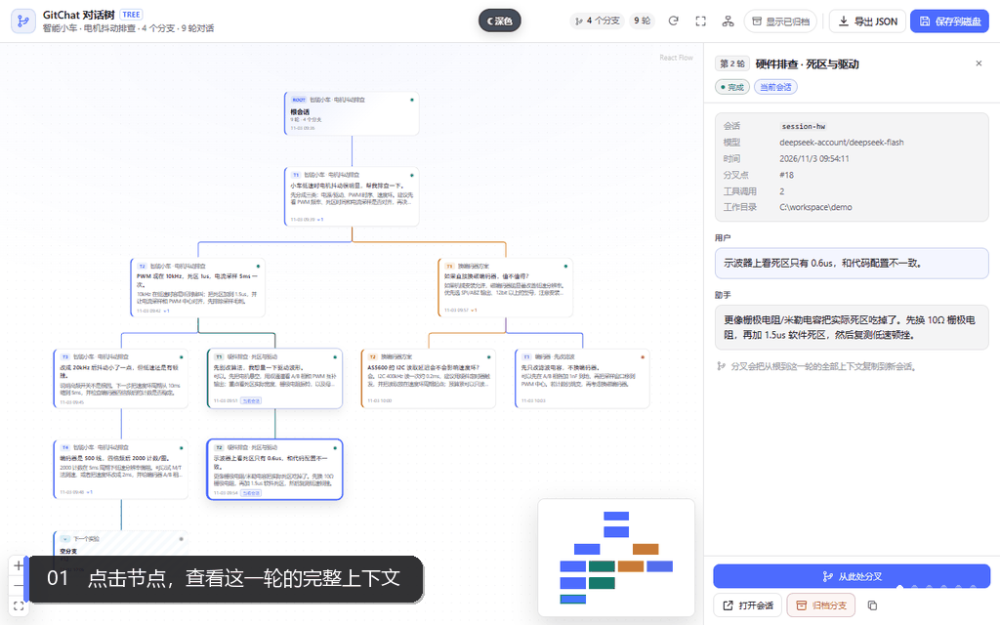
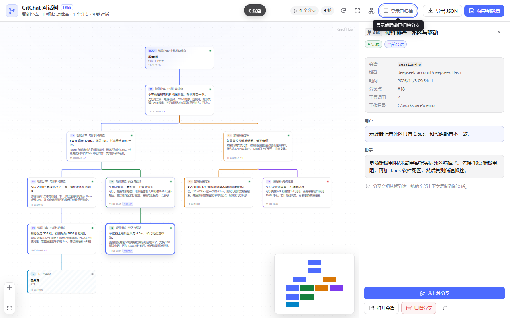
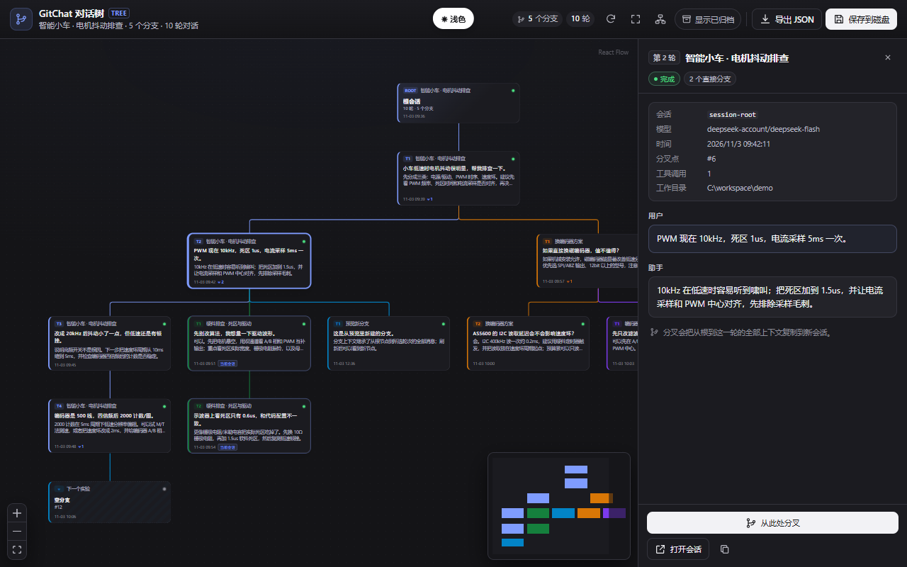
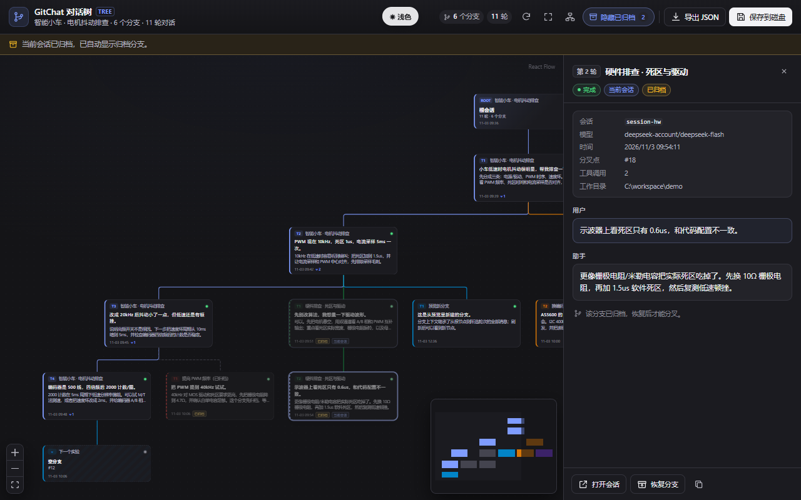
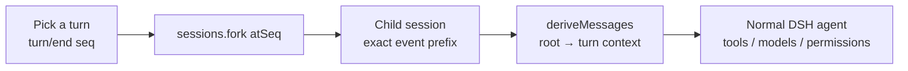
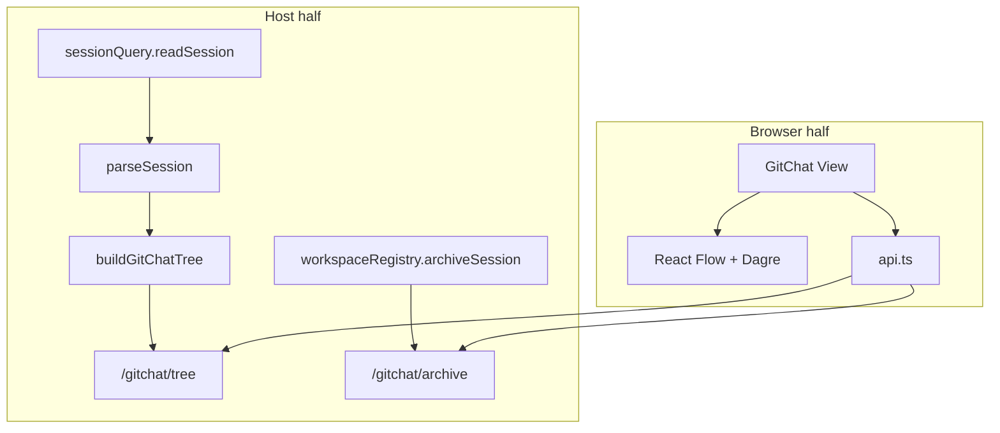
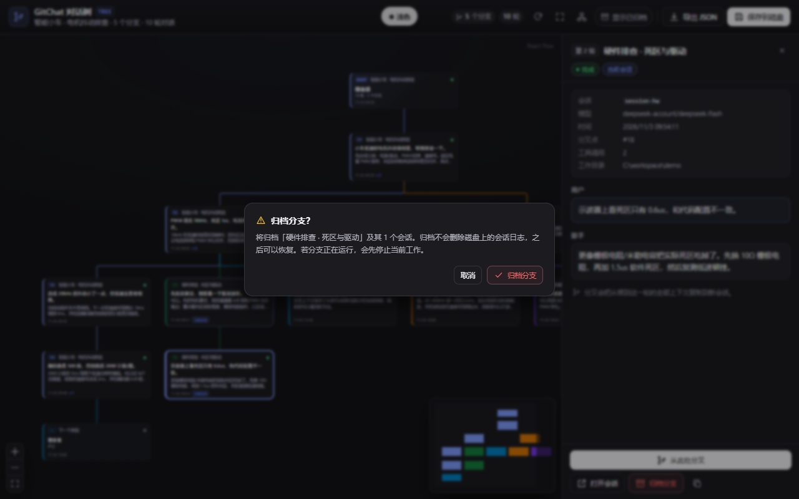

<div align="center">



# GitChat

**Conversations are trees. Your context should be too.**

A Git-like conversation tree for [DeepSeek Harness](https://github.com/deepseek-ai/deepseek-harness):
fork any turn, inherit the full context, and manage branches visually — without leaving the chat.

[](LICENSE)
[](#requirements)
[](https://reactflow.dev)
[](#requirements)
[](#roadmap)

[English](README.md) · [简体中文](README.zh.md)

> **New to Git/GitHub?** Read the [beginner's click-by-click guide](GITHUB_GUIDE.md) (Chinese, Windows) for creating a public repo, authenticating, pushing, and keeping it updated.

</div>



## The idea

Every long conversation eventually forks.

You ask a coding agent to fix a flaky motor driver. It tries three approaches. One works, two fail. A week later, the useful part is buried under a linear transcript, and the road not taken is gone.

You compare two architectures, two prompts, two models. The chat window makes you choose one and erase the other.

You want to keep the winning context and still explore “what if we changed only the encoder?” — but every new question drags the whole history forward.

**GitChat makes context a first-class object.** A conversation is a tree, not a line. Any turn can become the root of a new branch, and every branch carries the exact context that led to it.

## See it move

<p align="center">
  
</p>

<p align="center"><em>Standalone preview of the exact <code>GitChatView</code>: inspect a turn → hover an action → fork → switch to dark mode → archive and restore. The theme switch is preview-only.</em></p>

## Why Git-like

| Linear chat | GitChat |
|---|---|
| One timeline; history is a scrollbar | A tree of turns with visible parentage |
| “Branching” means retyping the context | Fork copies the exact root → turn prefix into a real child session |
| Model context is implicit and fragile | Every branch inherits a deterministic DSH event prefix |
| Failed experiments pollute the main thread | Archive the dead end; restore it later |
| Sharing means copying prose | Export the whole tree as structured JSON |

## Not a Webview

DSH is not VS Code. It has no Webview layer and no `postMessage` bridge for plugins.

GitChat is a **native dual-face DSH plugin**:

- the **host half** reads session logs and serves `/gitchat/*` routes;
- the **browser half** mounts a React component directly into the existing `conversation.view` slot;
- React Flow + Dagre render the tree; the DSH theme, locale, session, and model layers are reused.

That means no iframe, no custom CSP dance, no duplicate chat UI, and no second model integration. The plugin inherits the shell’s CSP and injects its stylesheet through the same `style[data-plugin-css]` mechanism as official plugins.

### CSP

- **Native plugin:** runs inside the DSH GUI and inherits the shell CSP; there is no separate document to configure.
- **Standalone preview:** ships a strict policy — `default-src 'none'; script-src 'self'; style-src 'self' 'unsafe-inline'; img-src 'self' data:; font-src 'self' data:; connect-src 'none'; base-uri 'none'; form-action 'none'`. `style-src 'unsafe-inline'` is only for React Flow’s transform styles.
- **If you ever wrap this in an iframe:** you would additionally need `frame-src`, `script-src`, `style-src`, and a `postMessage` protocol. GitChat deliberately avoids that layer.

## The 30-second tour

1. **Open GitChat.** On a session with at least one turn, click **GitChat** next to Chat / Trajectory.
2. **Click a node.** The inspector shows the user prompt, assistant reply, model, timestamp, tool-call count, and fork point.
3. **Hover any action.** Every toolbar button and detail action has a theme-aware tooltip that explains what it does — including *why* a disabled fork is disabled.
4. **Fork from here.** GitChat calls `sessions.fork({ sessionId, atSeq: turn.endSeq })`. The child inherits the exact event prefix and opens as a normal DSH session.
5. **Archive a dead end.** The branch and all fork descendants are archived (not deleted), then can be restored from the same view.
6. **Export.** Download the full tree JSON or write a snapshot under `~/.dsh/plugin-data/dsh-gitchat/exports/`.

| Inspect | Hover |
|---|---|
|  |  |

| Dark / dynamic-range mode | Archive & restore |
|---|---|
|  |  |

## Features

- **Tree-first conversation** — one node per turn, colored fork edges, Dagre layout, React Flow pan/zoom/minimap.
- **Real context inheritance** — branches are real DSH child sessions; no hand-built `messages` arrays.
- **Fork from any closed turn** — click a node, then *Fork from here*. Running turns are intentionally not forkable.
- **Open session** — jump to the session that owns an ancestor or sibling turn.
- **Non-destructive archive** — subtree archive with rollback on failure; archived branches are muted and restorable.
- **Full-tree JSON** — export includes archived branches; the snapshot is a read model, not a raw log dump.
- **Theme-native UI** — light, dark, and dynamic-range themes; semantic DSH tokens instead of hard-coded colors.
- **Hover / focus tooltips** — portaled, collision-aware, and readable in every theme.
- **Live refresh** — while a turn is running, the tree refreshes every 7 seconds; idle trees do not poll.
- **Chinese + English** — locale dictionaries registered through the DSH locale service.
- **Responsive** — the inspector becomes an overlay on narrow screens.

## Under the hood

### Branch = DSH fork



DSH’s fork copies the inclusive event prefix, writes `session/end-seed`, closes any open turn, and records `parentSession`. GitChat never reconstructs the model context by hand.

### Tree = derived read model



For every session in the fork lineage, the host reads the event log and its exact `inheritedEventCount`:

- inherited events are not duplicated as nodes;
- each session contributes only its own turns;
- a child’s first own turn attaches to the parent turn containing the fork boundary;
- nested forks walk up the lineage;
- empty forks become “empty branch” nodes; unreadable logs become error nodes.

### Archive is not delete

DSH has no public session-delete API. “Delete branch” archives the target and its fork descendants through `workspaceRegistry.archiveSession(id, { stopActivity: true })`, rolls back already-archived sessions on failure, and remains restorable. Session logs stay on disk.

<p align="center">
  
</p>

### Theme tokens, not guesses

A subtle DSH detail worth documenting: `--dsw-alias-brand-primary` is a **contrast** token — dark in light mode, light in dark mode. Using it as a blue CTA fill and pairing it with `#fff` text produced white-on-white buttons in dark mode.

GitChat now uses the correct semantic pairs:

```css
/* accents that should stay blue */
--gc-brand: var(--dsw-alias-button-info-fill, #4d6bfe);

/* CTAs: fill and label always flip together */
--gc-primary-fill: var(--dsw-alias-button-primary-fill);
--gc-primary-fg: var(--dsw-alias-label-primary-inverted);
--gc-primary-hover: var(--dsw-alias-button-primary-hover);
```

### Tooltips that explain disabled actions

Native `title` attributes are slow, and disabled buttons do not fire pointer events in every browser. GitChat wraps each action in a small `GcTooltip`:

- shows on hover **and** keyboard focus;
- portals to `<body>`, so it is never clipped by the view or inspector;
- flips above/below based on available space;
- reads DSH tooltip tokens for light/dark contrast;
- is intentionally below the modal layer, so an open dialog always wins.

## Requirements

- **DeepSeek Harness** `>= 0.2.1-rc.3` (developed against the `0.2.1-rc.5` plugin/session APIs).
- **Node.js** `^22.19.0 || >=24.0.0`.
- **pnpm** 11+ for development.
- A DSH profile such as `desktop` or `web`.
- Network access for devDependencies at build time; the plugin has **no runtime npm dependencies**.

## Quick start

```bash
git clone https://github.com/shuirongshen/dsh-git-fork-chat.git
cd dsh-git-fork-chat
pnpm install
pnpm build
```

Artifacts:

- `lib/index.js` — host half (ESM).
- `lib/client.js` — browser half, wrapped for DSH’s lazy-CJS module loader.
- `preview/` — a standalone preview with an in-memory mock controller.

The repository already contains built `lib/` and `preview/` artifacts, so the standalone preview can run without installing dev dependencies:

```bash
node scripts/preview-server.mjs
# open http://127.0.0.1:5177/
```

## Install into DSH

> This repository is installed as a **linked profile plugin**, not a VS Code extension. You need a local clone and a DSH profile.

### 1. Link the package

```bash
dsh plugin --profile desktop add link:<absolute-path-to-this-repo>
```

If `dsh` is not on `PATH`, use the CLI shipped with the app:

```powershell
# Windows
& "$env:LOCALAPPDATA\Programs\DeepSeek Harness\resources\runtime\cli\bin\dsh.cmd" `
  plugin --profile desktop add link:<absolute-path-to-this-repo>
```

Quote the path if it contains spaces.

### 2. Add the profile bundle

Edit `~/.dsh/profiles/desktop/package.json` (on Windows: `%USERPROFILE%\.dsh\profiles\desktop\package.json`) and append `"dsh-gitchat"` to `dsh.profile.bundles`:

```json
{
  "dsh": {
    "profile": {
      "bundles": [
        "@deepseek-ai/dsh-base",
        "@deepseek-ai/dsh-web-app",
        "dsh-gitchat"
      ]
    }
  }
}
```

**This step is required.** `dsh plugin add` only installs the package. The package’s `dsh.bundle.patch` (`cordis.patch.yml`) is applied only for entries in `dsh.profile.bundles`; that patch inserts `ui-gitchat` into the profile tree.

### 3. Restart DSH

Close and reopen DeepSeek Harness, open a session with at least one turn, and click **GitChat**.

### 4. Verify

```bash
dsh --profile desktop --dump-config | grep -i "ui-gitchat\|dsh-gitchat"
```

On Windows PowerShell:

```powershell
dsh --profile desktop --dump-config | Select-String "ui-gitchat|dsh-gitchat"
```

### Uninstall

1. Remove `"dsh-gitchat"` from `dsh.profile.bundles`.
2. `dsh plugin --profile desktop remove dsh-gitchat`.
3. Restart DSH.

## Usage

| Action | What it does |
|---|---|
| Click a node | Inspect the turn and its metadata |
| Fork from here | Create a real child session with the exact root → turn context |
| Open session | Navigate to the session that owns this node |
| Archive branch | Archive the branch and all fork descendants; logs stay on disk |
| Restore branch | Restore an archived branch from “Show archived” |
| Show archived | Reveal archived branches as muted nodes |
| Export JSON | Download the full tree, including archived branches |
| Save to disk | Write a snapshot under `~/.dsh/plugin-data/dsh-gitchat/exports/` |
| Refresh / Fit / Re-layout | Reload, fit the viewport, or discard drag positions |

## Use cases

### Debug a coding agent without losing the good timeline

The agent tried three fixes. Approach #2 is the only one that works, but you want to keep exploring from the last known-good turn. Fork there, keep `main` clean, and archive the failed experiments.

### Compare architectures, not just answers

Write one root brief, fork it three ways: “event-driven”, “state machine”, “polling”. Each branch keeps the same requirements and constraints but diverges in the solution. Compare the model’s reasoning side by side.

### Keep the winning context for a long task

Long sessions accumulate context that is expensive to recreate. Fork at the point where the context is best, then start the next phase with that exact prefix.

### Teach, demo, and hand off

A tree is an argument map. Export it as JSON, or show the branches in the GitChat view. A teammate can see which alternatives were tried and why they were abandoned.

### Explore model / prompt changes

Fork the same turn with a different prompt or model selection. The parent context is identical, so the comparison is actually controlled.

## Security and boundaries

- **Loopback only** — `/gitchat` rejects non-loopback requests with 403.
- **No shell, no user paths** — the only file write goes to a fixed plugin-data directory with a sanitized filename.
- **No HTML injection** — message text is rendered as React text, never `dangerouslySetInnerHTML`.
- **No model-facing surface** — GitChat registers no tools and writes no system prompt. It reads logs, calls `sessions.fork`, and archives sessions.
- **64 KiB JSON body cap**; JSON only.
- **Subagent sessions are excluded**; the root session cannot be archived.
- **Archive is non-destructive**; DSH has no public delete-session API.

## Limits

- No true session deletion; archive only. Logs remain on disk and in DSH’s archive list.
- JSON is a **read-model snapshot**, not a raw event-log backup. Messages are capped at 20,000 characters; tool calls are stored as counts.
- Large trees are capped at 80 sessions / 800 turns, with a `truncated` flag.
- Live refresh is polling (7 s while a turn is running), not server push.
- Loopback only; remote Web/paired access is rejected.
- DSH’s session/slot APIs are evolving; upgrading DSH may require updates to `src/host/dsh.ts` and `src/client/adapter.ts`.
- Corrupt or migration-required logs surface as unreadable placeholders rather than disappearing silently.

## Development

```bash
pnpm typecheck   # tsc --noEmit
pnpm test        # in-process Node test runner
pnpm build       # host + browser bundles
pnpm preview     # standalone preview bundle
```

Tests cover event parsing, single/nested forks, empty and archived branches, every `/gitchat` route, loopback rejection, the client module wrapper, `apply`, and slot registration.

A small utility can inspect a real DSH v4 log:

```bash
node scripts/inspect-session.mjs <session.v4.jsonl.zstd>
```

## Repository layout

```text
src/host/        Cordis host plugin, /gitchat routes, tree & lineage derivation
src/client/      React Flow view, DSH adapter, API, Dagre layout, tooltips, i18n, CSS
src/shared/      host ↔ browser wire types
preview/         standalone preview with an in-memory controller
test/            unit and integration tests
scripts/         build / preview / test / inspect-session
docs/            screenshots, demo GIF, publishing guide
cordis.patch.yml profile bundle patch inserting ui-gitchat
```

## Roadmap

- [x] Native DSH view, forks, archive/restore, JSON
- [x] Theme-native light/dark/dynamic-range buttons
- [x] Hover/focus tooltips for every action
- [x] Standalone preview and demo GIF
- [ ] Branch comparison view (side-by-side transcripts)
- [ ] Search across branches
- [ ] Optional true-delete with explicit confirmation and backup
- [ ] More model-provider presets

## Contributing

Issues and PRs are welcome. See [CONTRIBUTING.md](CONTRIBUTING.md) for setup, test, and review guidelines. For release steps, see [docs/PUBLISHING.md](docs/PUBLISHING.md).

## License

MIT — see [LICENSE](LICENSE). Bundled third-party notices: [THIRD_PARTY_NOTICES.md](THIRD_PARTY_NOTICES.md).

## Acknowledgements

- [DeepSeek Harness](https://github.com/deepseek-ai/deepseek-harness) for the plugin, session, slot, and theme architecture.
- [React Flow](https://reactflow.dev) for the graph surface.
- [Dagre](https://github.com/dagrejs/dagre) for layered tree layout.
- Every long debugging session that deserved a better branch.
