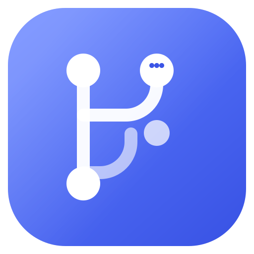
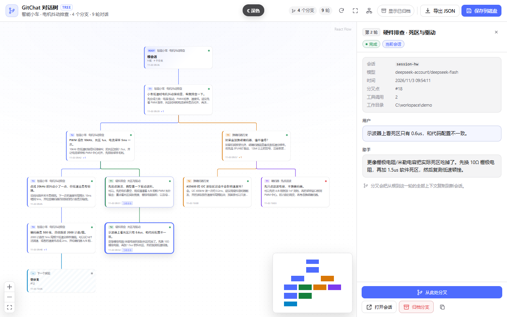
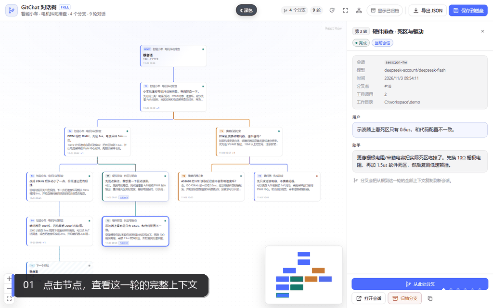
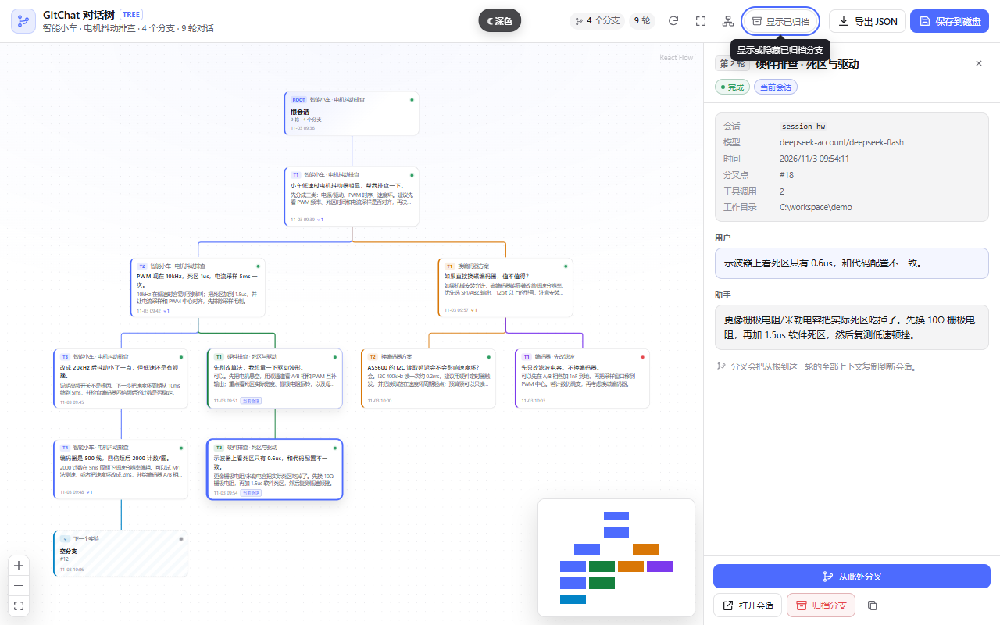
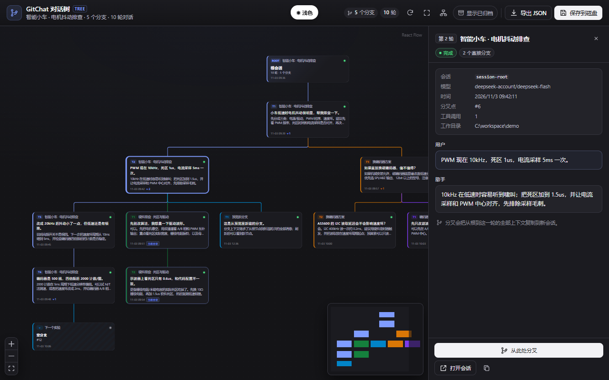
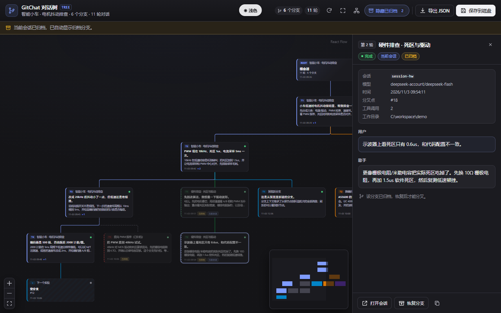
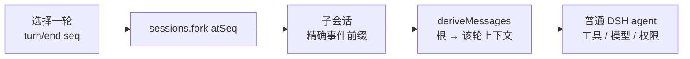
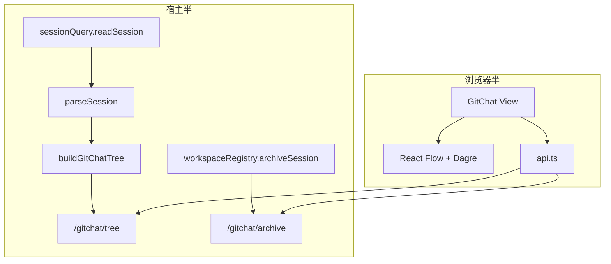
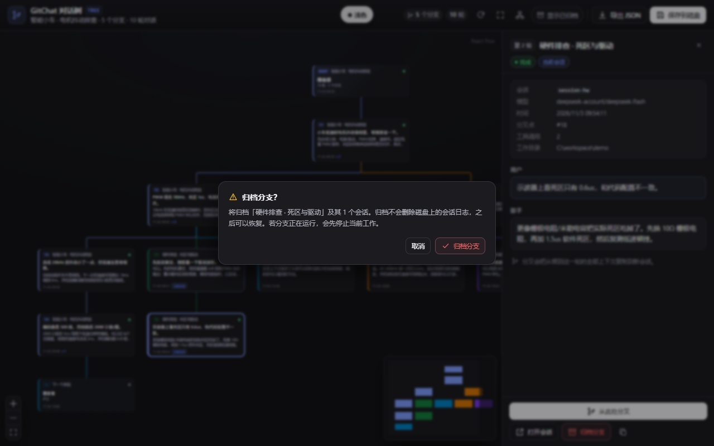

<div align="center">



# GitChat

**对话是树，上下文也应该是。**

给 [DeepSeek Harness](https://github.com/deepseek-ai/deepseek-harness) 的 Git 式对话树：
从任意一轮分叉、完整继承上下文，在聊天界面里直接管理你的分支。

[](LICENSE)
[](#环境要求)
[](https://reactflow.dev)
[](#环境要求)
[](#路线图)

[English](README.md) · [简体中文](README.zh.md)

> **第一次用 GitHub？** 看 [保姆级教程：创建公开仓库、登录、推送、持续更新](GITHUB_GUIDE.md)。从注册账号到每天的 `git push` 都有逐步说明。

</div>



## 为什么需要 GitChat

每一段足够长的对话，最终都会分叉。

你让 coding agent 修一个电机驱动抖动问题。它试了三种方案：一种有效，两种失败。一周后，有用的那部分被埋在一条线性 transcript 里，而“没走的那条路”已经找不回来了。

你比较两种架构、两种 prompt、两个模型。聊天窗口逼你选一个，然后把另一个擦掉。

你想保留已经跑通的上下文，同时继续探索“如果只换编码器会怎样？”——但每问一个新问题，都要把整段历史重新拖进来。

**GitChat 把上下文变成一等公民。** 对话是一棵树，不是一条线。任意一轮都可以成为新分支的根，每个分支都精确携带通向它的上下文。

## 先看它动起来

<p align="center">
  
</p>

<p align="center"><em>独立预览中的真实 <code>GitChatView</code>：查看节点 → 悬停按钮 → 分叉 → 切换深色模式 → 归档与恢复。主题切换按钮仅预览页有。</em></p>

## 为什么是 Git 式

| 线性聊天 | GitChat |
|---|---|
| 只有一条时间线，历史靠滚动条 | 一棵带明确父子关系的对话树 |
| “分叉”意味着重新输入上下文 | Fork 精确复制根 → 该轮的事件前缀，生成真实子会话 |
| 模型上下文是隐式且脆弱的 | 每个分支都继承确定性的 DSH 事件前缀 |
| 失败的实验污染主线程 | 归档死胡同，随时恢复 |
| 分享等于复制一段长文 | 整棵树导出为结构化 JSON |

## 不是 Webview

DSH 不是 VS Code。它没有 Webview 层，也没有给插件用的 `postMessage` 桥。

GitChat 是一个 **原生 DSH 双端插件**：

- **宿主半**读取会话日志，提供 `/gitchat/*` HTTP 路由；
- **浏览器半**把 React 组件直接挂进现有的 `conversation.view` 插槽；
- React Flow + Dagre 负责渲染，DSH 的主题、locale、会话、模型层全部复用。

所以没有 iframe、没有额外的 CSP 适配、没有重复的聊天 UI、也没有第二套模型接入。插件继承 shell 的 CSP，用与官方插件相同的 `style[data-plugin-css]` 方式注入样式。

### CSP

- **原生插件**：运行在 DSH GUI 内，继承 shell CSP；没有独立文档需要额外配置。
- **独立预览**：使用严格策略 —— `default-src 'none'; script-src 'self'; style-src 'self' 'unsafe-inline'; img-src 'self' data:; font-src 'self' data:; connect-src 'none'; base-uri 'none'; form-action 'none'`。`style-src 'unsafe-inline'` 仅用于 React Flow 的 transform 内联样式。
- **如果未来要套 iframe**：还需要 `frame-src`、`script-src`、`style-src` 和 `postMessage` 协议。GitChat 刻意避免了这一层。

## 30 秒上手

1. **打开 GitChat**：在至少有一轮对话的会话里，点击 Chat / Trajectory 旁边的 **GitChat**。
2. **点击节点**：右侧显示用户消息、助手回复、模型、时间、工具调用数和分叉点。
3. **悬停任意操作**：工具栏与详情区的每个按钮都有跟随主题的 tooltip，连“为什么这个分叉按钮不可用”都会解释。
4. **从此处分叉**：调用 `sessions.fork({ sessionId, atSeq: turn.endSeq })`，子会话继承精确的事件前缀，并作为普通 DSH 会话打开。
5. **归档死胡同**：整条子分支被归档（不是删除），之后可以在同一视图里恢复。
6. **导出**：下载整棵树 JSON，或写入 `~/.dsh/plugin-data/dsh-gitchat/exports/`。

| 查看节点 | 悬停提示 |
|---|---|
|  |  |

| 深色 / 动态范围模式 | 归档与恢复 |
|---|---|
|  |  |

## 功能

- **树状对话**：每轮一个节点，彩色 fork 边，Dagre 自动布局，React Flow 拖拽/缩放/小地图。
- **真实上下文继承**：分支是真实的 DSH 子会话，不手工拼 `messages`。
- **任意已结束轮次可分叉**：运行中的轮次刻意不允许从图中分叉。
- **打开会话**：跳转到拥有该节点的祖先或兄弟会话。
- **非破坏性归档**：子树归档，失败自动回滚；归档分支灰显且可恢复。
- **完整树 JSON**：包含归档分支；这是读模型快照，不是原始日志备份。
- **主题原生**：亮色、深色、动态范围模式；全部使用 DSH 语义 token，不硬编码颜色。
- **悬停 / 聚焦 tooltip**：portal 渲染、自动避让、亮暗主题都可读。
- **运行中自动刷新**：存在运行中的轮次时每 7 秒刷新；空闲树不轮询。
- **中英文**：通过 DSH locale 服务注册字典。
- **响应式**：窄屏时详情面板变为覆盖层。

## 工作原理

### 分支 = DSH fork



DSH 的 fork 会复制 inclusive 事件前缀、写入 `session/end-seed`、关闭未完成的 turn，并在子会话 header 里记录 `parentSession`。GitChat 从不手写模型上下文。

### 树 = 从日志推导的读模型



对谱系中的每个会话，宿主读取事件日志和它的 `inheritedEventCount`：

- 继承前缀不重复建节点；
- 每个会话只贡献自己的 turn；
- 子会话第一个自己的 turn 挂到“包含分叉边界的父 turn”上；
- 嵌套 fork 沿谱系向上找到真正的祖先；
- 空 fork 显示为“空分支”，读取失败的日志显示为错误节点。

### 归档不是删除

DSH 没有公开的“删除会话”API。所谓的“删除分支”实际是：通过 `workspaceRegistry.archiveSession(id, { stopActivity: true })` 归档目标会话及其所有 fork 后代；中途失败会回滚已归档的会话；之后随时可以恢复。磁盘上的 session 日志不会被删除。

<p align="center">
  
</p>

### 主题 token，而不是猜颜色

一个值得写进文档的 DSH 细节：`--dsw-alias-brand-primary` 是**对比色** token——亮色模式下接近黑色，深色模式下接近白色。把它当蓝色 CTA 背景，再配 `#fff` 文字，就会出现深色模式下的白底白字。

GitChat 现在使用正确的语义组合：

```css
/* 需要保持蓝色的强调色 */
--gc-brand: var(--dsw-alias-button-info-fill, #4d6bfe);

/* CTA：背景与文字始终成对翻转 */
--gc-primary-fill: var(--dsw-alias-button-primary-fill);
--gc-primary-fg: var(--dsw-alias-label-primary-inverted);
--gc-primary-hover: var(--dsw-alias-button-primary-hover);
```

### 能解释“为什么不可用”的 tooltip

原生 `title` 太慢，而且禁用按钮在部分浏览器里不触发指针事件。GitChat 用一个小型 `GcTooltip` 包裹每个操作：

- 悬停**和**键盘聚焦都能显示；
- portal 到 `<body>`，不会被视图或详情面板裁掉；
- 根据空间自动向上/向下翻转；
- 读取 DSH tooltip token，亮暗主题都清晰；
- 刻意位于 modal 层之下，弹窗打开时永远让位。

## 环境要求

- **DeepSeek Harness** `>= 0.2.1-rc.3`（在 `0.2.1-rc.5` 的插件/会话 API 上开发）。
- **Node.js** `^22.19.0 || >=24.0.0`。
- **pnpm** 11+（开发时需要）。
- 一个 DSH profile，例如 `desktop` 或 `web`。
- 构建需要网络安装 devDependencies；**插件运行时没有 npm 依赖**。

## 快速开始

```bash
git clone https://github.com/<your-username>/dsh-gitchat.git
cd dsh-gitchat
pnpm install
pnpm build
```

产物：

- `lib/index.js`：宿主半，ESM。
- `lib/client.js`：浏览器半，已包装成 DSH 的 lazy-CJS 模块。
- `preview/`：带内存 mock controller 的独立预览。

仓库已经包含构建好的 `lib/` 与 `preview/`，只想看效果时无需安装依赖：

```bash
node scripts/preview-server.mjs
# 打开 http://127.0.0.1:5177/
```

## 安装到 DSH

> 这是一个 **profile link 插件**，不是 VS Code 扩展。你需要本地 clone 和一个 DSH profile。

### 1. 链接包

```bash
dsh plugin --profile desktop add link:<absolute-path-to-this-repo>
```

如果 `dsh` 不在 `PATH`，使用应用自带的 CLI：

```powershell
# Windows
& "$env:LOCALAPPDATA\Programs\DeepSeek Harness\resources\runtime\cli\bin\dsh.cmd" `
  plugin --profile desktop add link:<absolute-path-to-this-repo>
```

路径包含空格时请加引号。

### 2. 把包加入 profile bundles

编辑 `~/.dsh/profiles/desktop/package.json`（Windows：`%USERPROFILE%\.dsh\profiles\desktop\package.json`），在 `dsh.profile.bundles` 末尾加入 `"dsh-gitchat"`：

```json
{
  "dsh": {
    "profile": {
      "bundles": [
        "@deepseek-ai/dsh-base",
        "@deepseek-ai/dsh-web-app",
        "dsh-gitchat"
      ]
    }
  }
}
```

**这一步不能省。** `dsh plugin add` 只把包装进 `node_modules`；只有进入 `dsh.profile.bundles`，包的 `dsh.bundle.patch`（`cordis.patch.yml`）才会被应用，`ui-gitchat` 这一行才会插入 profile 树。

### 3. 重启 DSH

关闭并重新打开 DeepSeek Harness，打开一个至少有一轮对话的会话，点击 **GitChat**。

### 4. 验证

```bash
dsh --profile desktop --dump-config | grep -i "ui-gitchat\|dsh-gitchat"
```

Windows PowerShell：

```powershell
dsh --profile desktop --dump-config | Select-String "ui-gitchat|dsh-gitchat"
```

### 卸载

1. 从 `dsh.profile.bundles` 移除 `"dsh-gitchat"`。
2. `dsh plugin --profile desktop remove dsh-gitchat`。
3. 重启 DSH。

## 使用

| 操作 | 作用 |
|---|---|
| 点击节点 | 查看这一轮的消息与元信息 |
| 从此处分叉 | 创建真实子会话，精确继承根 → 该轮上下文 |
| 打开会话 | 跳转到拥有该节点的会话 |
| 归档分支 | 归档该分支及所有 fork 后代；日志保留在磁盘 |
| 恢复分支 | 在“显示已归档”中恢复 |
| 显示已归档 | 以灰显节点展示归档分支 |
| 导出 JSON | 下载包含归档分支的完整树 |
| 保存到磁盘 | 写入 `~/.dsh/plugin-data/dsh-gitchat/exports/` |
| 刷新 / 适应画布 / 重新布局 | 重新读取、fit view、丢弃拖拽位置重新布局 |

## 用途演示

### 调试 coding agent，同时保住“能跑的那条时间线”

Agent 试了三种修法，只有第二种有效。你想从最后一个 known-good 轮次继续探索，又不想污染主线。从那里 fork，把失败实验归档，主线保持干净。

### 比较架构，而不只是比较答案

写一份根需求，分三路 fork：“事件驱动”“状态机”“轮询”。每个分支携带同一份约束，但在方案上分道扬镳。并排比较模型的推理，而不是在一条时间线里来回删改。

### 为长任务保留最佳上下文

长会话的上下文重建成本很高。在上下文最好的那个点 fork，下一阶段带着精确前缀开始。

### 教学、演示与交接

一棵树就是一张论证地图。导出 JSON，或直接在 GitChat 视图里展示分支。队友能看见试过哪些方案、为什么放弃。

### 比较模型 / prompt 变化

从同一轮 fork，换 prompt 或换模型。父上下文完全一致，比较才是受控的。

## 安全与边界

- **仅回环地址**：`/gitchat` 拒绝非 loopback 请求（403）。
- **不执行 shell、不接受用户路径**：唯一写文件的是导出快照，路径固定在 plugin-data，文件名经过清洗。
- **无 HTML 注入**：消息用 React 文本节点渲染，不使用 `dangerouslySetInnerHTML`。
- **无模型副作用**：不注册工具、不写 system prompt，只读日志、调用 `sessions.fork`、归档会话。
- **请求体上限 64 KiB**；只接受 JSON。
- **子代理会话不进入树**；根会话不能归档。
- **归档是非破坏性的**；DSH 没有公开的删除会话 API。

## 已知限制

- 没有真正的“删除会话”；归档是当前能力下的安全选择，日志仍在磁盘和 DSH 归档列表里。
- JSON 是**读模型快照**，不是原始事件日志备份；每条消息最多 20,000 字符，工具调用只保留计数。
- 大会话上限 80 个会话 / 800 个 turn，超出标记 `truncated`。
- 运行中刷新是 7 秒轮询，不是服务端推送。
- 仅回环地址；远程 Web/配对设备访问会被 403。
- DSH 的 session/slot API 仍在演进；升级 DSH 后可能需要同步调整 `src/host/dsh.ts` 和 `src/client/adapter.ts`。
- 损坏或 migration-required 的日志会显示为不可读占位节点，而不是静默消失。

## 开发

```bash
pnpm typecheck   # tsc --noEmit
pnpm test        # 进程内 Node 测试运行器
pnpm build       # 宿主 + 浏览器 bundle
pnpm preview     # 独立预览 bundle
```

测试覆盖事件解析、单层/嵌套 fork、空分支与归档分支、所有 `/gitchat` 路由、loopback 拒绝、客户端 module wrapper、`apply` 和 slot 注册。

辅助脚本可以检查真实 DSH v4 日志：

```bash
node scripts/inspect-session.mjs <session.v4.jsonl.zstd>
```

## 目录结构

```text
src/host/        Cordis 宿主插件、/gitchat 路由、树与谱系推导
src/client/      React Flow 视图、DSH adapter、API、Dagre 布局、tooltip、i18n、CSS
src/shared/      宿主 ↔ 浏览器 wire 类型
preview/         独立预览（内存 mock controller）
test/            单元/集成测试
scripts/         build / preview / test / inspect-session
docs/            截图、演示 GIF、发布指南
cordis.patch.yml profile bundle patch：插入 ui-gitchat
```

## 路线图

- [x] 原生 DSH 视图、fork、归档/恢复、JSON
- [x] 亮色/深色/动态范围主题按钮
- [x] 所有操作的悬停/聚焦 tooltip
- [x] 独立预览与演示 GIF
- [ ] 分支并排对比视图
- [ ] 跨分支搜索
- [ ] 可选的真删除（显式确认 + 备份）
- [ ] 更多模型 provider 预设

## 参与贡献

欢迎 Issue 与 PR。开发、测试和评审规范见 [CONTRIBUTING.md](CONTRIBUTING.md)；发布步骤见 [docs/PUBLISHING.md](docs/PUBLISHING.md)。

## License

MIT，见 [LICENSE](LICENSE)。打包的第三方声明见 [THIRD_PARTY_NOTICES.md](THIRD_PARTY_NOTICES.md)。

## 致谢

- [DeepSeek Harness](https://github.com/deepseek-ai/deepseek-harness)：插件、会话、slot 与主题架构。
- [React Flow](https://reactflow.dev)：图形画布。
- [Dagre](https://github.com/dagrejs/dagre)：分层树布局。
- 每一段值得拥有更好分支的长调试会话。
